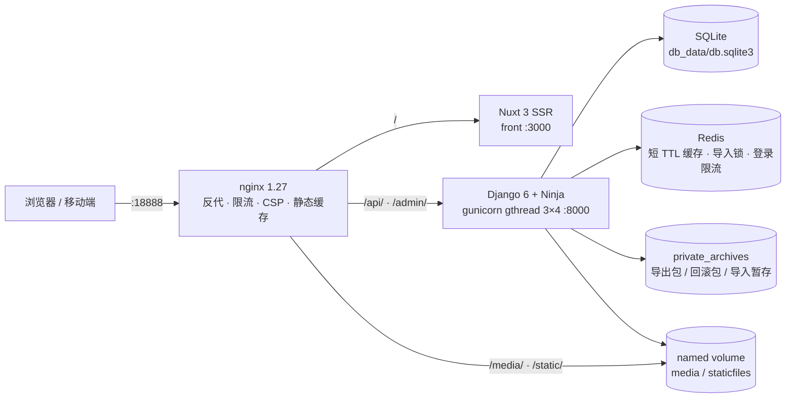

<div align="center">

# my_blog · 旅行博客

**Django 6 + Django Ninja 后端 · Nuxt 3 前端的个人博客系统**

前后端分离 · Markdown 写作 · 文章归档导入导出 · Docker 一键部署


</div>

---

一个自用向的**旅行游记博客**：后端提供纯 JSON API（Django 6 + Django Ninja），前端是 Nuxt 3 的
SSR 站点，内容用 Markdown 写作，图片一律在服务端压成 WebP 后落盘。除常规增删改查外，它还实现了
**文章归档的导入/导出**（把自己的内容打成可移植的 zip 包）、**HTML 便签导入**（手机导出的一整篇
HTML 直接转 Markdown）以及面向部署机的运维脚本 `scripts/blog.sh`。

> 📌 仓库的**设计 SSOT** 是 [`DESIGN.md`](./DESIGN.md)；面向 AI 与协作者的工程约定、踩坑清单在
> [`AGENTS.md`](./AGENTS.md)。README 只做入门与总览。

## 目录

- [功能特性](#功能特性)
- [技术栈](#技术栈)
- [系统架构](#系统架构)
- [快速开始](#快速开始)
- [配置项](#配置项)
- [API 概览](#api-概览)
- [数据模型](#数据模型)
- [项目结构](#项目结构)
- [测试与质量门禁](#测试与质量门禁)
- [部署与运维](#部署与运维)
- [已知限制与设计取舍](#已知限制与设计取舍)
- [文档索引](#文档索引)

---

## 功能特性

### ✍️ 内容创作

- **Markdown 正文**：`Article.content` 存 Markdown 原文，服务端渲染 → `nh3` 白名单消毒 →
  回填 `loading/decoding/target/rel`，公开接口返回 `content_html`；渲染器每请求新建（`Markdown.convert()` 非线程安全）。
- **正文插图**：上传即压成 WebP、**内容寻址**落盘 `media/inline/<sha256[:32]>.webp`（同图自动去重），
  nginx 按一年 `immutable` 缓存；未引用插图由 `purge_inline_images` 回收站 + 两遍扫描回收。
- **HTML 导入**：手机/第三方导出的 HTML → Markdown（`/admin/articles/convert-html/`）。
  内联 base64 图自动压成 WebP 落盘、外链图保留、`file://` 等不可读来源移除并告警；
  修掉了便签导出的两个通病（行尾反斜杠硬换行渲染成字面量 `\`、4 空格首行缩进被当成代码块）。
- **封面必填、附件可选**：封面 JPG/PNG/WebP ≤20MB，经 `articles/covers.py` 统一压成 WebP
  （最长边 ≤1600、质量 82、剥 EXIF/ICC，落盘扩展名恒为 `.webp`）；附件 PDF/Word ≤50MB。
  管线**幂等**——已达标文件原样返回，这是导出→导入幂等的前提。
- **分类 / 标签**：完整 CRUD；`slug` 省略时由名称自动生成（中文转拼音），冲突自动加 `-2` 后缀；
  未填分类/标签时惰性挂默认分类与默认标签，二者受删除保护。
- **后台**：`django-unfold` 美化的 Django Admin + Nuxt 管理端（文章列表/筛选/排序/分页/批量删除、Markdown 编辑器与预览）。

### 📖 阅读体验

- 公开列表（分类 / 标签 / 文章）**60s 短 TTL 缓存**，任一写操作经信号失效，并同步 `Cache-Control: public, max-age=60`。
- 搜索 `GET /articles/search/?keyword=`：**标题 / 摘要 / 正文**模糊匹配，统一分页信封。
- 阅读量**首次访问才 +1**：按「IP + 文章」3600s 去重；计数用 `F('views') + 1` 在 SQL 层原子自增，并发阅读不丢更新。
- Nuxt 3 SSR 前端：暗 / 亮主题、皮肤切换（`elegant` / `neon`）、Element Plus 中文文案、响应式列表与卡片。
- SEO：站点级标题模板、description、`og:site_name`；图标**构建期打包**，内网/离线部署不依赖 `api.iconify.design`。

### 📦 文章归档（导入 / 导出）

- **导出**为 zip 包（格式 v2）：`article.json` + Markdown 正文 + 内容寻址插图 + 封面/附件；导入**同时兼容 v1**（v1 缺正文与插图，会显式告警）。
- **两阶段导入**：`stage`（上传 + 校验，返回预检报告）→ `commit`（只传 `staged_id`，不重传文件）；
  另有 `plan` 预览最终态、`limits` 查询配额、`DELETE stage/{id}` 放弃。
- **容量按实际条目配平**（≤2000 条目 / ≤1GiB 未压缩 / JSON ≤2MiB / 单次导出 ≤1000 篇），
  导出与导入用同一套计数（含固定成员与每张图），**产出的包不会被自己拒收**。
- **一次性能力 URL** 下载：`auth=None`、单次使用、重复访问 410、可 `reissue` 重签；票据在 URL 里，故该 location 关闭 access log。
- **单写者保护**：缓存 `SET NX` 全局导入锁（缓存不可用时 fail-closed 503）+ 同用户最小导入间隔 60s；
  与 nginx 的 `limit_conn archive_conn 2`（连接层）互补。
- **产物幂等与清扫**：媒体比对**产物哈希**而非源字节哈希（重编码后仍相等）；`purge_archives` 清理过期包与暂存。

### 🔐 安全与运维

- **JWT**：access 2h / refresh 7d，`ROTATE_REFRESH_TOKENS` + `BLACKLIST_AFTER_ROTATION`（刷新即轮换、旧令牌进黑名单）。
- **鉴权分层**：管理接口一律 staff 鉴权——匿名 401、普通登录用户 403；项目无公开注册，账号只能在 admin 创建。
- **限流**：登录按「IP + 用户名」失败 5 次锁 5 分钟（429）；nginx 侧对 `login` / `admin` 5r/s、归档 1r/s、预览 5r/s。
- **响应头**：CSP、`X-Content-Type-Options: nosniff`、`X_FRAME_OPTIONS=DENY`、`Referrer-Policy`。
- **统一信封** `{code, message, data}` + 全局异常处理器（HttpError / ValidationError / 500 兜底且不泄露内部信息）。
- **容器自愈**：四服务 `restart: unless-stopped`，app/redis 带 healthcheck，nginx 用 `condition: service_healthy` 排队。
- **多阶段镜像**：app 与 front 均多阶段构建（builder 装依赖 → 运行阶段只带 venv / `.output`）。
- **一体化运维** `scripts/blog.sh`：预检 / 启停 / 状态 / 日志 / 质量门禁 / 端到端冒烟 / 离线导出导入 / 备份 / 清理。
- **CI**：Gitea Actions 双 job（后端 ruff + mypy + 迁移一致性 + pytest；前端 ESLint + vue-tsc + vitest）。

## 技术栈

| 层次 | 选型 | 版本 | 说明 |
| :--- | :--- | :--- | :--- |
| 语言 | Python | 3.12+ | `uv` 管理依赖与虚拟环境 |
| Web 框架 | Django | 6.x | 单体应用 + Admin 作为 CMS |
| API 框架 | Django Ninja | ≥1.3 | Pydantic v2 校验，Swagger UI 在 `/api/v1/docs` |
| 认证 | django-ninja-jwt | ≥5.4.5 | 兼容 `SIMPLE_JWT` 配置键，含 token 黑名单 |
| 数据库 | SQLite | - | `db_data/db.sqlite3`（dev/prod 同款；PostgreSQL 配置已预留未启用） |
| 缓存 / 锁 | Redis | 7 | `REDIS_URL` 存在即启用；未配置回落 LocMemCache 并告警 |
| Markdown | Python-Markdown + markdownify + nh3 | - | 渲染 / HTML→MD / 消毒（nh3 是唯一消毒边界） |
| 图像 | Pillow | ≥10 | 封面与插图统一压 WebP，剥 EXIF/ICC |
| 后台 UI | django-unfold | ≥0.103 | Django Admin 现代化皮肤 |
| 前端 | Nuxt 3 + Vue 3 | 3.21 / 3.5 | SSR，Element Plus 2.x + Tailwind CSS |
| 前端运行时 | Node.js | 22 (alpine) | 构建期 `npm ci + build`，运行期只带 `.output` |
| 前端质量 | ESLint 10 / vue-tsc / Vitest 5 | - | flat config，只留正确性规则 |
| 服务 | Gunicorn (gthread) + nginx | 23 / 1.27 | `3 workers × 4 threads`，nginx 反代 + 限流 + CSP |
| 容器 | Docker / Podman + Compose | - | 脚本自动探测 `docker compose` → `docker-compose` → `podman-compose` → `podman compose` |

## 系统架构



- 对外**只有 nginx 一个入口**（宿主机 `:18888`）；app 的 `:8000`、front 的 `:3000`、redis 均不暴露到宿主机。
- 容器启动链：`db_data/` 先 `migrate` → `collectstatic` → `purge_archives` → gunicorn；
  nginx 等 app 健康后才启动，避免冷启动 502。
- `private_archives/`（归档产物、上传暂存）**绝不在 `MEDIA_ROOT` 下**：nginx 对 `/media/` 无鉴权且 `expires 7d`。

## 快速开始

### 方式一：Docker Compose（推荐）

```bash
cp .env.example .env          # 首次可跳过：blog.sh 会自动生成并校验必填项
scripts/blog.sh preflight     # 环境体检：引擎/架构/SELinux/端口/磁盘/配置语法
scripts/blog.sh up --build    # 构建 → 重建容器 → 等就绪 → 健康检查
scripts/blog.sh status        # 容器/镜像/端口/健康/归档产物/磁盘一览
```

首次部署后创建管理员：

```bash
scripts/blog.sh logs app -f   # 确认 migrate / collectstatic / gunicorn 正常
docker compose exec app python manage.py createsuperuser
```

访问：站点 `http://<IP>:18888/`、后台 `http://<IP>:18888/admin/`、API 文档 `http://<IP>:18888/api/v1/docs`（生产默认关闭，需 `ENABLE_API_DOCS=true`）。

### 方式二：本地开发

```bash
uv sync                                              # 安装依赖（含 dev 组）
mkdir db_data                                        # SQLite 目录（Windows: mkdir db_data）
uv run python manage.py migrate                      # 建表
uv run python manage.py createsuperuser              # 建管理员
uv run python manage.py runserver 0.0.0.0:8000       # 局域网可访问
```

前端另开一个终端：

```bash
cd front && npm install && npm run dev               # http://localhost:5173
```

Nuxt dev server 通过 `nitro.devProxy` 把 `/api/`、`/media/` 代理到 `http://127.0.0.1:8000`，无需 nginx；
生产则由 nginx 统一代理。逐步说明、接口手工测试（Swagger / curl / Postman）与原生 Docker 手动步骤见
[`docs/DEVELOPMENT.md`](./docs/DEVELOPMENT.md)。

## 配置项

Django 由 `DJANGO_ENV` 选择配置（`config/settings/{dev,prod}.py`，`DJANGO_SETTINGS_MODULE` 恒为 `config.settings`）。
`.env` 只被 compose 的 `env_file` 消费，**Django 不会自动加载**（手工跑 prod 需自行 `export`）。

| 变量 | 默认 | 说明 |
| :--- | :--- | :--- |
| `DJANGO_ENV` | `dev` | `dev` 用 SQLite + 内存缓存 + `DEBUG=True`；`prod` 缺 `DJANGO_SECRET_KEY` 直接抛错 |
| `DJANGO_SECRET_KEY` | - | prod 必填 |
| `DJANGO_ALLOWED_HOSTS` | `localhost,127.0.0.1` | 逗号分隔；dev 为 `*` |
| `REDIS_URL` | - | compose 自动注入 `redis://redis:6379/0`；缺失时 prod 回落 LocMemCache（多 worker 下锁/限流退化为每进程一把） |
| `DJANGO_USE_TLS` | `false` | 打开 SSL 重定向、安全 Cookie、`SECURE_PROXY_SSL_HEADER`、HSTS |
| `DJANGO_SECURE_HSTS_SECONDS` | `0` | HSTS 秒数 |
| `DJANGO_CSRF_TRUSTED_ORIGINS` | - | 信任来源，逗号分隔 |
| `ENABLE_API_DOCS` | `false` | 生产是否开放 `/api/v1/docs`（dev 恒开） |
| `ARCHIVE_ROOT` | `private_archives/` | 归档产物目录，compose 内为 `/app/private_archives` |
| `FILE_UPLOAD_TEMP_DIR` | 系统临时目录 | 上传暂存目录，compose 内为 `/app/tmp` |

其余配额类常量（封面/插图尺寸、归档容量、票据 TTL 等）在 `config/settings/base.py` 中集中定义，均有中文注释。

## API 概览

Base URL：`/api/v1/`；认证：`Authorization: Bearer <access>`；成功统一信封 `{"code": 200, "message": "success", "data": ...}`。

### 认证（`users`）

| 方法 | 路径 | 认证 | 说明 |
| :--- | :--- | :--- | :--- |
| POST | `/login/` | ❌ | 登录，返回 `access` + `refresh`；失败 5 次 / 5 分钟限流 |
| POST | `/token/refresh/` | ❌ | 刷新并轮换 refresh，旧令牌进黑名单 |
| GET | `/me/` | ✅ JWT | 当前用户信息 |

### 公开接口（`articles`）

| 方法 | 路径 | 说明 |
| :--- | :--- | :--- |
| GET | `/categories/` | 分类列表（60s 缓存） |
| GET | `/tags/` | 标签列表（60s 缓存） |
| GET | `/articles/` | 文章列表，分页，支持 `category_slug` 过滤（60s 缓存） |
| GET | `/articles/search/` | `keyword` 模糊搜索标题/摘要/正文，分页信封 |
| GET | `/articles/{slug}/` | 详情（含消毒后的 `content_html`），按 IP 去重后 +1 阅读量 |

### 管理接口（staff）

| 方法 | 路径 | 说明 |
| :--- | :--- | :--- |
| GET / POST | `/admin/articles/` | 列表（含草稿，`is_published`/`keyword`/`category_slug` 过滤，`ordering` 白名单排序）/ 创建（multipart，封面必填） |
| GET / PUT / DELETE | `/admin/articles/{article_id}/` | 详情（含原始 Markdown）/ 更新 / 删除（联动清理封面与附件文件） |
| DELETE | `/admin/articles/slug/{slug}/` | 按 slug 删除 |
| POST | `/admin/articles/bulk-delete/` | 批量删除 |
| POST | `/admin/articles/preview/` | Markdown 渲染预览（不落库） |
| POST | `/admin/articles/images/` | 上传正文插图 → WebP 内容寻址落盘，返回 URL |
| POST | `/admin/articles/convert-html/` | HTML → Markdown（≤100MiB，文件通道），附带 `suggested_title` |
| POST / GET / PUT / DELETE | `/admin/categories/…`、`/admin/tags/…` | 分类 / 标签完整 CRUD（JSON body） |
| GET / POST | `/admin/articles/export/`、`/admin/articles/export/estimate/` | 导出归档包 / 预估体积 |
| POST | `/admin/articles/import/stage/`、`/import/plan/`、`/import/commit/` | 两阶段导入：上传校验 → 预览 → 提交 |
| DELETE | `/admin/articles/import/stage/{id}/` | 放弃暂存包 |
| GET | `/admin/articles/import/limits/` | 导入配额 |
| GET / POST | `/admin/archives/{ticket}/`、`/admin/archives/{ticket}/reissue/` | 一次性下载票据（`auth=None`，重复访问 410）/ 重签 |

> 路由顺序敏感：`/admin/articles/export/`、`preview/`、`images/`、`convert-html/` 等都是 `articles` 后的**单段路径**，
> 必须注册在 `/admin/articles/{article_id}/` 之前，否则会被解析成 `article_id`。

## 数据模型

| 模型 | 关键字段 | 说明 |
| :--- | :--- | :--- |
| `users.User` | `AbstractUser` + `avatar` / `avatar_name` | JPG/PNG ≤2MB，落盘 `avatars/%Y/%m/UUID.ext`，`AUTH_USER_MODEL='users.User'` |
| `articles.Article` | `title` `slug` `summary` `content` `publish_time` `location` `cover_image` `file` `author` `category` `tags` `is_published` `views` `created_at` `updated_at` | 封面必填（WebP）、附件可选、正文为 Markdown |
| `articles.Category` | `name` `slug` `description` | 删除时文章 `category` 置空；默认分类受保护 |
| `articles.Tag` | `name` `slug` | 删除仅解除 M2M 关联；默认标签受保护 |
| `articles.ArchiveTicket` | `kind` `path` `filename` `bytes` `expires_at` `used_at` | 一次性下载票据（UUID 主键），默认 TTL 300s |
| `articles.ArchiveStaging` | `dir` `bytes` `entries` `expires_at` `consumed_at` `lease_until` | 导入暂存包，默认 TTL 1800s |

字段级细节（约束、upload_to、索引）见 [`DESIGN.md` §4](./DESIGN.md)。

## 项目结构

```text
my_blog/
├── config/                     # Django 配置：settings/{base,dev,prod}.py、urls.py、wsgi/asgi
├── common/                     # 统一响应信封、异常处理器、client_ip、公共 Schema、缓存头中间件
├── users/                      # 自定义 User + JWT 登录/刷新/me、头像校验、限流
├── articles/                   # 核心业务
│   ├── api.py                  # 公开 + 管理路由（含归档、预览、插图、HTML 导入）
│   ├── models.py               # Article / Category / Tag / ArchiveTicket / ArchiveStaging
│   ├── rendering.py            # Markdown 渲染 + nh3 消毒 + 属性回填
│   ├── covers.py images.py     # 封面压缩管线 / 插图内容寻址落盘
│   ├── convert.py              # HTML → Markdown
│   ├── caching.py signals.py   # 60s 公开缓存 + 写操作失效
│   ├── archive/                # 归档：export/validate/planner/importer/locks/staging/limits/format/errors
│   └── management/commands/    # purge_archives / purge_inline_images / recompress_covers
├── front/                      # Nuxt 3 前端（pages/ components/ composables/ layouts/ tests/）
├── docker/                     # entrypoint.sh（migrate+collectstatic+清扫）、nginx/nginx.conf
├── docs/                       # 专题文档（开发指南 / 归档格式 / 离线部署 / 备份恢复 / TLS 演练）
├── scripts/                    # blog.sh 运维入口、seed_demo.py、hooks/pre-push
├── tests/                      # pytest 用例（462 个，独立于各 app）
├── DESIGN.md                   # 系统设计 SSOT
├── AGENTS.md                   # 工程约定与踩坑清单
├── Dockerfile                  # app 多阶段构建
└── docker-compose.yml          # app / redis / nginx / front 四服务
```

## 测试与质量门禁

```bash
uv run pytest                                     # 462 个用例（pytest + pytest-django）
uv run ruff check .                               # Lint（E/F/W/I/UP/B，line-length 100）
uv run mypy config articles common users          # 类型检查（django-stubs 插件）

cd front && npm run lint && npx vue-tsc --noEmit && npm test   # 前端三件套

scripts/blog.sh check                             # 一次跑完全部门禁
scripts/blog.sh check --e2e                       # 追加真实链路冒烟（需已 up 的容器）
```

`blog.sh check` 除 lint / 类型 / 测试外还包含：**迁移一致性**（不得存在未生成迁移）、**配置语法**
（compose YAML / entrypoint / blog.sh / `nginx -t`）、**shellcheck**、**文档漂移自查**（`AGENTS.md`
声明的用例数必须等于实际 collection、其引用的 `docs/*.md` 必须存在）。

CI 见 [`.gitea/workflows/ci.yml`](./.gitea/workflows/ci.yml)：后端 job（ruff / mypy / 迁移 / pytest / shellcheck）
与前端 job（ESLint / vue-tsc / vitest）。本地可用 `scripts/blog.sh install-hooks` 装 pre-push 钩子获得等效门禁。

> ⚠️ 修改用例数量后，需同步 `AGENTS.md` 里的「当前 N 个」，否则 `blog.sh check` 会阻断。

## 部署与运维

`scripts/blog.sh` 是部署运维的统一入口，把「podman-compose 不会因镜像变更重建容器」「SELinux 需 `:z`」
「`.env` 必填校验」「轮询等就绪而非 `sleep`」等实测坑点固化成了代码：

| 子命令 | 用途 |
| :--- | :--- |
| `preflight` | 环境体检：引擎探测 / 架构 / SELinux / 端口占用 / 磁盘 / 配置语法 |
| `up [--build]` / `down [--purge]` / `restart` | 构建 → 重建容器 → 等就绪 → 健康检查；`--purge` 连数据卷一起删 |
| `status` / `logs [app\|nginx\|front\|redis] [-f]` | 状态一览 / 日志 |
| `check [--no-front] [--e2e]` | 质量门禁（可选跳过前端 / 追加端到端冒烟） |
| `e2e` | 对**已运行**容器跑真实链路：健康探活 → `POST /login/` → 建文章 → 导出并校验 zip（临时数据自动清理） |
| `backup [--out 文件]` | SQLite 热备 + `integrity_check`（恢复步骤见 `docs/BACKUP_RESTORE.md`） |
| `export [--out 文件]` / `import --in 文件` | 四个镜像打包成 tar + `.sha256` / 目标机校验 → load → 重建 → 健康检查（**绝不 `--build`**） |
| `seed-media` / `seed-demo [--count N]` | 把本机 `media/` 同步进媒体卷 / 生成并导入 N 篇演示游记 |
| `purge` / `install-hooks` / `help` | 清理过期产物与悬空镜像 / 启用 pre-push 门禁 / 帮助 |

完整参数与引擎差异处理见 `scripts/blog.sh help`；离线部署细节见
[`docs/OFFLINE_IMAGE_DEPLOY.md`](./docs/OFFLINE_IMAGE_DEPLOY.md)。

**数据持久化**：数据库走 bind mount `db_data/`（`rm -rf db_data` 即丢全站数据，务必先 `blog.sh backup`）；
`media/`、`staticfiles/`、`private_archives/`、上传暂存走 named volume；`docker compose down` 不删数据。

## 已知限制与设计取舍

- **prod 实际使用 SQLite**（`db_data/db.sqlite3`，`OPTIONS.timeout=20`）：同一时刻只允许一个写者，
  归档导入 / 批量删除等写密集场景可能遇到 `database is locked`，已用超时 + 导入锁串行化缓解；
  `prod.py` 的 PostgreSQL 配置是预留 TODO。若并发写显著增长，再启用 PostgreSQL。
- **生产必须配 Redis**：否则导入锁与登录限流退化为「每 worker 一把」，且 `prod` 会打 `RuntimeWarning`。
- **跨进程语义不做自动化覆盖**：pytest 跑 LocMemCache 单进程，复现不了跨 worker 行为，只能在部署机验证。
- **无公开注册**：账号只能在 Django Admin 创建；管理接口对普通登录用户返回 403。
- **Swagger 生产默认关闭**：`DEBUG=True` 或 `ENABLE_API_DOCS=true` 才注册，否则 404。
- **参数校验失败返回 422**（Pydantic 结构），与业务错误的统一信封不同，调用方需分别处理。
- **仅本地文件存储**：插图内容寻址落盘依赖 `default_storage.path()`，当前实现**仅适用本地 `FileSystemStorage`**；
  迁移到 OSS 需改造该路径。

## 文档索引

| 文档 | 内容 |
| :--- | :--- |
| [`DESIGN.md`](./DESIGN.md) | 系统设计 SSOT：定位、技术栈、数据模型、接口详规、部署、Git 规范 |
| [`AGENTS.md`](./AGENTS.md) | 面向 AI/协作者的工程约定、常用命令、逐条实测踩坑清单 |
| [`docs/DEVELOPMENT.md`](./docs/DEVELOPMENT.md) | 本地开发五步、前端联调、接口手工测试、原生 Docker 步骤 |
| [`docs/ARTICLE_IMPORT_EXPORT.md`](./docs/ARTICLE_IMPORT_EXPORT.md) | 文章归档格式与 D1–D24 设计决策 |
| [`docs/ARTICLE_MARKDOWN_PLAN.md`](./docs/ARTICLE_MARKDOWN_PLAN.md) | Markdown 正文与内联图方案 |
| [`docs/OFFLINE_IMAGE_DEPLOY.md`](./docs/OFFLINE_IMAGE_DEPLOY.md) | 离线镜像导出/导入部署 |
| [`docs/BACKUP_RESTORE.md`](./docs/BACKUP_RESTORE.md) | SQLite 备份与恢复流程 |
| [`docs/TLS_DRILL.md`](./docs/TLS_DRILL.md) | HTTPS/TLS 切换演练 |
| [`TEST.md`](./TEST.md) | 测试用例规范（历史草案 + 迭代增补，以 `tests/` 实际代码为准） |

## 许可证

仓库当前**未包含 `LICENSE` 文件**。这是个人自用项目，如需开源请先补充许可证（例如 MIT / CC BY-NC-SA），
并在 GitHub/Gitea 仓库设置中选择对应 License，否则默认保留所有权利。

---

<div align="center">

用 Markdown 记录旅程 · 用 zip 包带走全部内容

</div>
